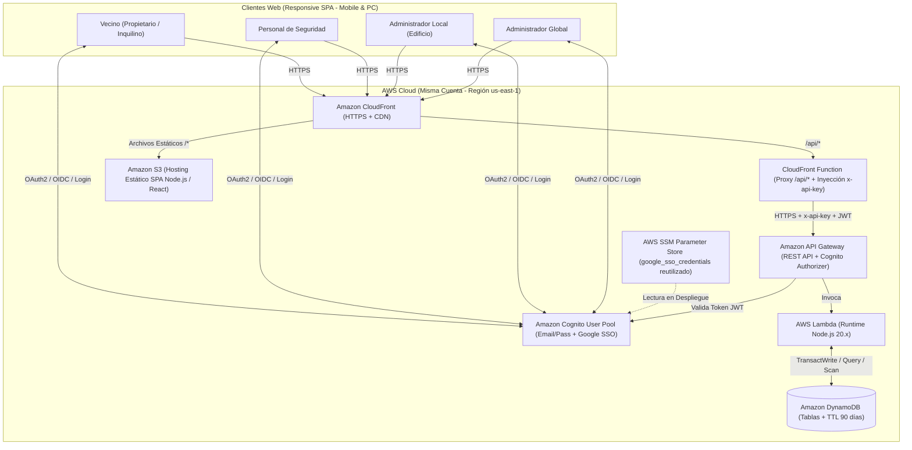
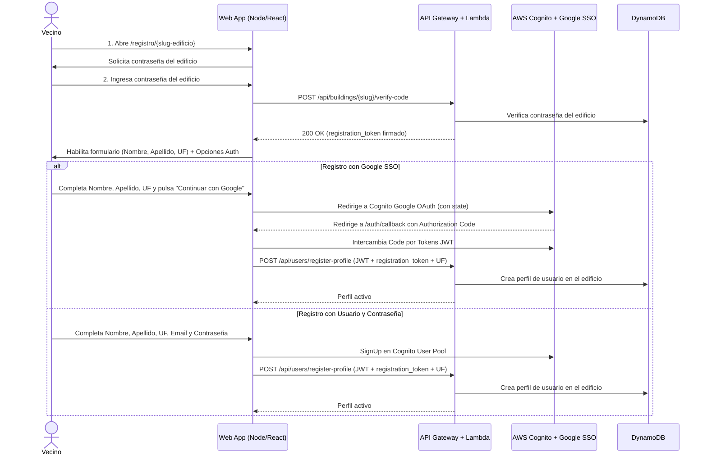

# Sistema de Gestión de Reservas de Amenities Multi-Edificio

Documento de Especificación Funcional, Arquitectura Técnica, Análisis de Riesgos y Propuesta de Mejoras.

---

## 1. Resumen Ejecutivo

El presente documento define el diseño integral, las reglas de negocio, la arquitectura cloud en AWS y el análisis crítico para el desarrollo de una plataforma web moderna y **100% responsive (Mobile-First & Desktop)** destinada a la **gestión y reserva de amenities en edificios/consorcios** (quinchos, parrillas, SUM, invitados a pileta, etc.).

El sistema está diseñado bajo un esquema **Multi-Edificio (Multi-Tenant)** administrado de forma centralizada y desplegado sobre **AWS Serverless** (S3, CloudFront, Cognito con Google SSO + Credenciales nativas, API Gateway, Lambda en Node.js y DynamoDB con TTL automático), tomando como referencia las buenas prácticas de infraestructura como código (Terraform + GitHub Actions OIDC) del repositorio guía (`_app4_backend_aws`, `_docs`, `_.github`) y evolucionándolas para este nuevo dominio de negocio.

---

## 2. Arquitectura de Alto Nivel y Reutilización de AWS

### 2.1 Diagrama de Arquitectura



### 2.2 Estrategia de Reutilización de la Cuenta AWS Existente

A partir del relevamiento de las carpetas de referencia (`_app4_backend_aws`, `_docs`, `_.github`), se adoptan y optimizan los siguientes componentes:

1. **Hosting, Proxy Seguro y Seguridad Perimetral (S3 + CloudFront + Resource Policy en API Gateway)**:
   - Se mantiene el patrón donde una **CloudFront Function** intercepta las peticiones a `/api/*`, las reescribe hacia el stage del API Gateway (`/prod/*`) e inyecta de forma transparente la cabecera `x-api-key`. El frontend jamás expone claves de API en el navegador.
   - **Prevención de Evasión de CloudFront**: La configuración de Terraform para API Gateway (`api_gateway.tf`) incorpora una **Resource Policy (`aws_api_gateway_rest_api_policy`)** que restringe el tráfico entrante para que únicamente acepte peticiones cuyo origen (`aws:SourceArn`) coincida con el ARN de la distribución de Amazon CloudFront, impidiendo que alguien que descubra la URL interna (`https://{api-id}.execute-api.us-east-1.amazonaws.com`) pueda invocar el API Gateway de forma directa evadiendo CloudFront.
2. **Autenticación con AWS Cognito y Reutilización de Google SSO**:
   - En la cuenta de AWS ya existe el parámetro `google_sso_credentials` en **AWS Systems Manager (SSM) Parameter Store**.
   - A diferencia del proyecto anterior (donde se dejaba un valor dummy para editar a mano), en nuestro Terraform utilizaremos un bloque `data "aws_ssm_parameter" "google_sso"` con `with_decryption = true` para leer automáticamente el `client_id` y `client_secret` existentes en la cuenta y vincularlos al proveedor de Google del User Pool.
   - Se habilitan simultáneamente dos métodos de autenticación en el User Pool Client: `COGNITO` (usuario y contraseña nativos con verificación de email) y `Google` (Federated SSO).
3. **CI/CD con GitHub Actions y OIDC**:
   - Se reutiliza el proveedor OIDC de la cuenta AWS (`token.actions.githubusercontent.com`) y el bucket S3 de estado de Terraform (`uade-qr-terraform-state-<ACCOUNT_ID>-us-east-1-an`), cambiando **obligatoriamente** la clave del estado (`key = "booking/terraform.tfstate"`) para aislar por completo esta infraestructura de la anterior.
4. **Stack Unificado en Node.js con `shadcn/ui` y `date-fns-tz`**:
   - **Frontend**: Aplicación Single Page Application (SPA) moderna construida sobre el ecosistema **Node.js 20+**, utilizando **React 18 + Vite + Tailwind CSS + shadcn/ui + Lucide Icons**, diseñada con enfoque *Mobile-First* para que funcione con fluidez tanto en cualquier celular como en pantallas de escritorio.
   - **Componentes Accesibles con `shadcn/ui` (Radix UI + Tailwind)**:
     - **Calendario y DatePicker (`Calendar` / `Popover` + `react-day-picker` + `date-fns`)**: Selección de fechas desde hoy en adelante, bloqueo de días inactivos y vista de calendario mensual/semanal de reservas.
     - **Modales y Confirmaciones (`Dialog` / `AlertDialog`)**: Cartel de confirmación obligatoria para eliminación definitiva de usuarios dados de baja, alta/edición de amenities y confirmación de reservas.
     - **Formularios y Controles (`Input`, `Label`, `Select`, `Switch`, `Checkbox`, `Textarea`, `Tabs`, `Badge`, `Card`, `Alert`)**: Configuración de turnos por día de la semana, toggles de *"Sin turnos"*, *"Mostrar en pantalla principal"* y bloqueo por deuda de expensas, con control total del código fuente en `src/components/ui/`.
   - **Backend Serverless Determinista**: Funciones AWS Lambda desarrolladas en **Node.js 20.x** (con AWS SDK v3 modular `@aws-sdk/client-dynamodb`, `@aws-sdk/lib-dynamodb` y **`date-fns-tz`** en su `package.json` para el manejo determinista de zonas horarias), logrando un único lenguaje en todo el repositorio.

---

## 3. Roles del Sistema y Modelo de Permisos

El sistema implementa Control de Acceso Basado en Roles (**RBAC**) combinado con aislamiento por edificio (**Multi-Tenancy**):

| Rol | Identificador | Alcance | Responsabilidades y Permisos Principales |
| :--- | :--- | :--- | :--- |
| **Administrador Global** | `global_admin` | Todos los edificios | • Crear, editar y desactivar edificios.<br>• Definir el `slug` (URL fija de registro) y la contraseña de registro de cada edificio.<br>• Crear y asignar Administradores Locales a cada edificio.<br>• Supervisar métricas o auditar cualquier edificio si fuera necesario. |
| **Administrador Local** | `building_admin` | Su(s) edificio(s) asignado(s) | • Configurar parámetros del edificio: contraseña de registro, **cantidad máxima de integrantes por Unidad Funcional (`max_users_per_unit`)**, mensaje personalizado de bloqueo por expensas y reglamento general.<br>• ABM completo de **Amenities** del edificio (turnos, días habilitados, cupos máximos, superposición, visibilidad en home).<br>• **Panel de Usuarios y Unidades Funcionales**: listar vecinos por Unidad Funcional, **configurar/designar al único Propietario (`owner`) de cada Unidad Funcional**, bloquear/desbloquear reservas por deuda de expensas, cambiar rol a `security`, **dar de baja usuarios (baja lógica por 1 año)** y **volver a dar de alta (reactivar) usuarios dados de baja**.<br>• Consultar historial de reservas hasta **90 días hacia atrás** y futuras (incluyendo amenities ocultos del home) y cancelar reservas por razones operativas. |
| **Seguridad / Portería** | `security` | Su edificio asignado | • Acceso de **solo lectura** al panel de control de accesos/reservas.<br>• Visualizar todas las reservas confirmadas del día, futuras y hasta **90 días hacia atrás**.<br>• Ve tanto los amenities públicos (ej. Quincho) como los ocultos de la pantalla principal (ej. Invitados Pileta), incluyendo nombre del vecino, Unidad Funcional, cantidad de invitados y comentarios. |
| **Propietario de UF** | `resident` (`owner`) | Su edificio y su Unidad Funcional | • **Máximo 1 por Unidad Funcional** (configurado/habilitado por el Administrador del Edificio).<br>• Posee todos los permisos de reserva de un vecino.<br>• Acceso al panel **"Mi Unidad Funcional"**, desde donde visualiza a los integrantes/inquilinos registrados en su misma Unidad Funcional y puede **dar de baja el acceso a un inquilino** (el registro queda dado de baja por 1 año bloqueando su email, pero libera de inmediato el cupo de la UF y cancela sus reservas futuras). |
| **Inquilino / Integrante** | `resident` (`tenant`) | Su edificio registrado | • Registrarse mediante la URL fija de su edificio ingresando la contraseña del consorcio (con **verificación obligatoria de email en Cognito** y sujeto al **cupo máximo de integrantes activos por Unidad Funcional**).<br>• Completar Nombre, Apellido y Unidad Funcional (tal como figura en las expensas).<br>• Realizar reservas de amenities (si no se encuentra bloqueado ni dado de baja) desde el día actual en adelante.<br>• Consultar y gestionar **"Mis Reservas"**.<br>• Visualizar en la pantalla principal las reservas de los amenities públicos en formato **Listado** o **Calendario**. |

---

## 4. Flujo Funcional Detallado

### 4.1 URL Fija por Edificio y Flujo de Registro Protegido

Cada edificio dado de alta por el Administrador Global posee un identificador único amigable (`slug`), generando una URL fija de registro:
- Ejemplo: `https://<dominio-cloudfront>/registro/torre-libertador` (o `/b/torre-libertador`).

#### Paso a paso del registro de un vecino:
1. **Ingreso a la URL del Edificio**:
   - El vecino accede al enlace provisto por la administración de su consorcio.
   - El sistema consulta los metadatos públicos mínimos del edificio (Nombre del edificio y si se encuentra activo).
2. **Validación de Contraseña del Edificio (Gate de Seguridad)**:
   - La pantalla solicita la **Contraseña del Edificio**.
   - Al enviarla, el backend valida el código contra el hash almacenado para ese edificio y emite un `registration_token` temporal firmado (validez: 30 minutos) vinculado a ese `building_id`.
3. **Elección del Método de Registro, Datos de Perfil y Validación de Cupo por Unidad Funcional**:
   - Una vez desbloqueada la pantalla de registro, el usuario completa sus datos obligatorios del consorcio:
     - **Nombre**
     - **Apellido**
     - **Unidad Funcional (UF)** (ej. `UF 042 - 4° B`, con texto de ayuda *"Ingresar tal como figura en la liquidación de expensas"*).
   - **Validación de Email No Dado de Baja y Máximo de Integrantes por Unidad Funcional (`max_users_per_unit`)**:
     - Si el correo electrónico ingresado (o autenticado vía Google) posee un registro en estado **Dado de Baja (`status = "DEACTIVATED"`)**, el sistema rechaza la creación/vinculación informando que ese correo fue dado de baja y que únicamente un Administrador del edificio puede volver a darle de alta.
     - Al enviar el registro, el backend normaliza el identificador de la Unidad Funcional (`unit_key`) y verifica cuántos usuarios **activos (`status = "ACTIVE"`)** ya se encuentran registrados en esa misma Unidad Funcional dentro del edificio.
     - Si la cantidad actual de integrantes activos alcanza o supera el parámetro `max_users_per_unit` configurado por el Administrador del Edificio, el registro es rechazado con un mensaje claro indicando que el cupo de usuarios de esa Unidad Funcional está completo y que el Propietario de la unidad o el Administrador debe dar de baja a los integrantes anteriores.
   - El usuario elige cómo autenticar su cuenta (con **verificación obligatoria de email en AWS Cognito**):
     - **Opción A — Usuario y Contraseña**: Ingresa su Email y Contraseña, se registra en Cognito, **verifica obligatoriamente su correo electrónico mediante el código enviado por Cognito** y se guarda su perfil activo vinculado al edificio en DynamoDB.
     - **Opción B — SSO con Google (Cognito)**:
       - Antes de redirigir al Hosted UI de Cognito (`identity_provider=Google`, donde Google provee el email ya verificado), la aplicación guarda en `sessionStorage` (y codifica en el parámetro OAuth `state`) el `registration_token` del edificio junto con los datos de Nombre, Apellido y Unidad Funcional ingresados.
       - Al volver del login de Google con el JWT de Cognito, el endpoint `POST /api/auth/register-profile` verifica el `registration_token` del edificio, comprueba que el email no esté dado de baja y crea el registro definitivo del vecino en DynamoDB.



---

### 4.2 Configuración de Amenities (Administrador Local)

El Administrador Local cuenta con un panel para crear y editar los amenities de su edificio. Cada amenity se configura con los siguientes parámetros:

1. **Nombre del Amenity**: Ej. *"Reserva Parrilla"*, *"Quincho Principal"*, *"Invitados Pileta"*.
2. **Instrucciones / Reglamento / Comentarios**:
   - Texto informativo del administrador (ej. *"Dejar limpio antes de las 02:00 hs"*).
   - Habilitación de un campo de **comentarios en la reserva** para que el vecino agregue notas o el listado de nombres de sus invitados.
3. **Capacidad Máxima de Invitados por Turno (`max_capacity`)**:
   - Define el **tope total de personas/invitados** admitidos simultáneamente en ese turno para el edificio (ej. `20` personas).
4. **Esquema de Horarios y Turnos por Día de la Semana**:
   - Configuración independiente para cada día (`Lunes` a `Domingo`):
     - Día habilitado / deshabilitado.
     - **Hasta 2 turnos máximo por día** (ej. *Turno Diurno*: `11:00` a `16:00` y *Turno Nocturno*: `19:00` a `01:00`).
5. **Opción "Sin Turnos" / Superposición Permitida (`no_shifts` / `allow_overlap`)**:
   - Cuando está **desmarcada** (Turnos Exclusivos o Turnos Fijos): las reservas se asocian estrictamente al Turno 1 o Turno 2 configurados.
   - Cuando está **marcada** ("Sin turnos"): permite que varios inquilinos/propietarios superpongan sus reservas dentro del horario hábil del día, eligiendo su hora de concurrencia y compartiendo el cupo máximo total de invitados (`max_capacity`) y el límite diario de reservas.
6. **Cantidad Máxima de Reservas por Día (`max_bookings_per_day`)**:
   - Limita la cantidad total de reservas distintas que se pueden efectuar en un mismo día para ese amenity (ej. máximo 1 reserva por turno en un quincho exclusivo, o máximo 5 reservas por día en sector parrillas/pileta).
7. **Opción "Mostrar en la pantalla principal" (`show_on_home`)**:
   - **Activado (`true`)**: Las reservas de este amenity aparecen en el listado y calendario general de la pantalla principal para que todos los vecinos sepan qué horarios están ocupados (ideal para Quincho / SUM / Parrilla).
   - **Desactivado (`false`)**: Las reservas **no** se exhiben en la pantalla principal pública del edificio (ideal para *"Invitados Pileta"*, preservando la privacidad de qué vecino invitó gente). Solo las visualizan el propio vecino en *"Mis Reservas"*, el **Administrador** y el personal de **Seguridad**.

---

### 4.3 Gestión de Usuarios, Cupo por UF, Único Propietario, Baja con Retención de 1 Año y Bloqueo por Expensas

En el panel de administración del edificio y en el perfil de Propietario:

1. **Límite de Integrantes por Unidad Funcional (`max_users_per_unit`)**:
   - El Administrador del Edificio configura la cantidad máxima de usuarios **activos** que pueden registrarse bajo una misma Unidad Funcional (ej. máximo `2`, `3` o `4` integrantes por UF).
   - El sistema agrupa a los vecinos por la clave normalizada de su Unidad Funcional (`unit_key`) y muestra en el panel del Administrador el indicador de ocupación activa de cada departamento (ej. `UF 4B: 2 / 3 integrantes activos`).
2. **Designación de un Único Propietario por Unidad Funcional (`owner`)**:
   - El Administrador del Edificio puede configurar **un (1) solo Propietario** por cada Unidad Funcional desde el Panel de Usuarios.
   - Si el administrador asigna como Propietario a un usuario de la UF `4B` donde ya existía otro usuario marcado como propietario, el sistema transfiere automáticamente la titularidad (convirtiendo al anterior en inquilino/integrante) para garantizar la regla estricta de **máximo un propietario por Unidad Funcional**.
3. **Baja de Acceso (por Propietario o Administrador) con Retención de 1 Año y Bloqueo de Email**:
   - Tanto el **Administrador del Edificio** (para cualquier vecino) como el **Propietario (`owner`)** (desde la sección **"Mi Unidad Funcional"** para los inquilinos de su departamento) pueden **eliminar / dar de baja el acceso** de un usuario.
   - **Comportamiento de la Baja Lógica (`status = "DEACTIVATED"`)**:
     - El registro del usuario en DynamoDB **no se elimina físicamente**, sino que queda marcado como **Dado de Baja (`status = "DEACTIVATED"`)** y su usuario en AWS Cognito es deshabilitado (`AdminDisableUser` + cierre global de sesiones `AdminUserGlobalSignOut`).
     - Como el registro permanece asociado a su email verificado en Cognito, **esa persona no puede volver a crear un usuario ni registrarse nuevamente con el mismo email**.
     - Se asigna automáticamente al registro un atributo de expiración `ttl` de **1 año (365 días)**:
       $$\text{ttl}_{\text{baja}} = \text{timestamp\_baja} + (365 \times 86400 \text{ segundos})$$
     - **Después de 1 año** sin haber sido rehabilitado, DynamoDB (y un trigger de limpieza hacia Cognito) **lo elimina definitivamente**, liberando ese correo electrónico.
     - **Efecto inmediato sobre la Unidad Funcional y las Reservas**: Al pasar a estado `DEACTIVATED`, el usuario **deja de ocupar cupo activo en la Unidad Funcional** (`active_users - 1`, permitiendo que un nuevo inquilino con otro correo se registre de inmediato) y se cancelan automáticamente todas sus **reservas futuras**, liberando el cupo de invitados en los amenities.
4. **Reactivación (Re-Alta) o Eliminación Definitiva de un Usuario con Baja**:
   - **Reactivación por el Administrador**:
     - Únicamente un **Administrador (`building_admin` o `global_admin`)** tiene la facultad de volver a **dar de alta (reactivar)** a un usuario que se encuentra en estado `DEACTIVATED` antes de que se cumpla el año de eliminación definitiva.
     - Desde la pestaña/filtro *"Usuarios Dados de Baja"*, el Administrador pulsa **"Dar de Alta / Reactivar"**: el sistema valida que la Unidad Funcional tenga cupo activo disponible (`active_users < max_users_per_unit`), cambia el estado a `status = "ACTIVE"`, **elimina el atributo `ttl`** de DynamoDB (`REMOVE ttl, deactivated_at`) para cancelar la purga anual, y vuelve a habilitar la cuenta en Cognito (`AdminEnableUser`).
   - **Eliminación Definitiva Manual (Luego de estar Dado de Baja) con Cartel de Confirmación**:
     - Una vez que un usuario ya se encuentra en estado **Dado de Baja (`status = "DEACTIVATED"`)**, se habilita la opción **"Eliminar Definitivamente"** (sin necesidad de esperar el año completo).
     - Al pulsar este botón, la interfaz despliega obligatoriamente un **cartel / modal de confirmación** advirtiendo que el usuario será eliminado definitivamente del sistema (y que la acción es irreversible, liberando su correo electrónico en Cognito y borrando el registro de DynamoDB).
     - Solo tras confirmar en dicho cartel se ejecuta el borrado físico (`DeleteItem` en DynamoDB + `AdminDeleteUser` en AWS Cognito).
5. **Padrón y Bloqueo Temporal por Mora de Expensas**:
   - A diferencia de la Baja de Acceso (cuando alguien deja de pertenecer al edificio o es dado de baja), el **Bloqueo por Expensas (`is_blocked = true`)** mantiene al vecino activo dentro del padrón de su Unidad Funcional pero le impide reservar amenities.
   - El Administrador Local puede configurar el **Mensaje de Bloqueo del Edificio** (ej.: *"No es posible efectuar reservas de amenities debido a que su Unidad Funcional registra deuda de expensas pendiente. Regularice su situación con la administración."*).
   - Si el usuario o su Unidad Funcional está bloqueada (`is_blocked = true`), al ingresar a la sección de Nueva Reserva **no se le listan los amenities** y se despliega el aviso configurado por el administrador.

---

### 4.4 Flujo de Reserva del Vecino y Control de Cupo Compartido

Cuando un vecino habilitado desea realizar una reserva:

1. **Selección del Amenity**: Elige entre los amenities activos de su edificio (ej. *"Reserva Parrilla"* o *"Invitados Pileta"*).
2. **Selección de Fecha**:
   - Despliega un calendario interactivo que bloquea cualquier fecha anterior al día de hoy (`minDate = hoy` en la zona horaria del edificio) y deshabilita los días de la semana en que el amenity no opera.
3. **Selección de Turno / Horario**:
   - Si el amenity opera por turnos, muestra los turnos configurados para ese día de la semana (Turno 1 y/o Turno 2).
   - Si el amenity está configurado "Sin turnos", muestra el rango horario habilitado del día y permite indicar la hora de ingreso dentro de dicha franja.
4. **Aviso en Tiempo Real de Reservas Existentes y Cupo Restante**:
   - Al seleccionar la fecha y el turno/franja, la aplicación consulta las reservas activas para esa combinación y evalúa la capacidad:
   - Si ya existen reservas en ese mismo turno (y aún queda cupo disponible), se muestra un cartel de aviso obligatorio:
     > ⚠️ **Aviso:** Actualmente existe(n) reserva(s) en este mismo turno por un total de **X personas**. El cupo máximo restante que podés solicitar es de **Y personas** (Capacidad máxima del edificio: **Z personas**).
   - Si el cupo total de invitados (`Z`) o la cantidad máxima de reservas por día ya se alcanzó, el turno se muestra como **"Completo / Sin Cupo"** y el botón de confirmar permanece deshabilitado.
5. **Ingreso de Cantidad de Invitados y Comentarios**:
   - El campo numérico de `Cantidad de invitados` valida automáticamente que `1 <= invitados <= (max_capacity - invitados_ocupados)`.
   - El vecino puede agregar comentarios opcionales (si el amenity lo habilita) y confirma la reserva.
6. **Confirmación e Impacto en Vistas**:
   - La reserva confirmada aparece de inmediato en el menú **"Mis Reservas"** del usuario.
   - Si el amenity tiene `show_on_home = true`, se refleja inmediatamente en la **Pantalla Principal** del edificio.

---

### 4.5 Pantalla Principal: Vista Listado y Vista Calendario

En la pantalla principal de la aplicación (Home del Edificio):
- **Filtro por Amenity**: Píldoras (chips) o selector superior para ver *"Todos los amenities públicos"* o filtrar por uno en particular (ej. *Parrilla*, *Quincho*).
- **Botón Conmutador de Vista (Toggle Listado / Calendario)**:
  - **Vista Listado (Responsive Cards / Tabla)**: Muestra cronológicamente desde hoy en adelante los días y turnos ya reservados por tipo de amenity, indicando el horario, el estado de ocupación (ej. *"Ocupado"* o *"Parcial: 10/20 personas"*) y la Unidad Funcional.
  - **Vista Calendario (Grilla Mensual / Semanal adaptable a móvil)**: Muestra un calendario visual con indicadores de color por amenity en cada día; al tocar un día en el celular o hacer clic en PC, despliega el detalle de los turnos reservados en esa fecha.

---

### 4.6 Rol de Seguridad y Retención Histórica de 90 Días

1. **Panel de Seguridad (Portería / Guardia)**:
   - Interfaz limpia, de alto contraste y optimizada para tablets/celulares de guardia o PC de recepción.
   - Permite consultar todas las reservas (incluyendo aquellas con `show_on_home = false`, como *"Invitados Pileta"*).
   - Filtros por **Fecha** (desde **90 días atrás** hasta fechas futuras), por **Amenity** y búsqueda instantánea por **Unidad Funcional** o **Apellido**.
   - **Estricto permiso de solo lectura**: no puede crear reservas, ni modificar parámetros del edificio, ni bloquear vecinos.
2. **Eliminación Automática a los 90 Días (DynamoDB TTL)**:
   - Tanto el **Administrador** como **Seguridad** tienen un selector de fechas históricas limitado a `hoy - 90 días`.
   - En DynamoDB, cada ítem de reserva almacena un atributo numérico `ttl` en formato Unix Epoch equivalente a:
     $$\text{ttl} = \text{timestamp\_fin\_reserva} + (90 \times 86400 \text{ segundos})$$
   - DynamoDB purga automáticamente los registros vencidos en segundo plano sin consumir capacidad de escritura ni requerir tareas cron adicionales.

---

## 5. Análisis Meticuloso de Problemas Potenciales y Soluciones

A continuación se detallan los problemas técnicos, operativos y de negocio que pueden presentarse en este tipo de sistemas y cómo los resolveremos en la arquitectura:

### Problema 1: Condición de Carrera y Manejo de Conflictos en Transacciones de DynamoDB (`TransactionConflictException`)
- **Escenario**: Un amenity admite máximo 20 personas y ya hay una reserva de 10 personas. Dos vecinos distintos envían una reserva al mismo milisegundo. Si no hay control atómico, se superaría la capacidad máxima; pero al utilizar `TransactWriteItems` sobre el mismo ítem de control (`SLOT#...`) en el mismo milisegundo, DynamoDB bloqueará el recurso para una de las peticiones y lanzará un error `TransactionConflictException` (o `TransactionCanceledException` por conflicto de transacción), aun cuando todavía quedara cupo disponible para ambas.
- **Solución Técnica**:
  1. **Control Atómico de Cupo**: Ejecutar la reserva mediante **`TransactWriteItems`** actualizando el contador acumulado del turno (`SLOT#<YYYY-MM-DD>#AMENITY#<id>#SHIFT#<id>`) con una `ConditionExpression`:
     `guests_count + :new_guests <= :max_capacity AND bookings_count + :one <= :max_bookings`.
  2. **Reintentos con Exponential Backoff y Jitter**: La función Lambda asociada al endpoint `POST /api/buildings/{building_id}/reservations` implementa un mecanismo de reintentos con **Exponential Backoff y Jitter (aleatoriedad)** (ej. hasta 4 intentos esperando $\text{random}(25\text{ms}, 2^{\text{intento}} \times 60\text{ms})$). Si ocurre un `TransactionConflictException`, el código Node.js captura el error, espera unos milisegundos aleatorios, **vuelve a consultar el cupo restante actualizado** y, si el cupo sigue siendo suficiente, reintenta la transacción de forma transparente, evitando que el vecino reciba un error `500` por una colisión temporal.

### Problema 2: Limitación de `callback_urls` en AWS Cognito con URLs por Edificio
- **Escenario**: Cada edificio tiene su propia URL fija (ej. `/registro/edificio-a`, `/registro/edificio-b`). AWS Cognito **no permite comodines (`*`) dinámicos en las rutas de `callback_urls`** y exige que cada URL esté declarada en la configuración del App Client. Si el Administrador Global crea un nuevo edificio desde la interfaz web, Google SSO fallaría si intentara volver a una URL de callback no declarada en Terraform.
- **Solución Técnica**: Configurar en Cognito una **única URL de callback canónica** para toda la SPA (ej. `https://<cloudfront-domain>/auth/callback`). Cuando un vecino entra por `https://<cloudfront-domain>/registro/torre-norte` e inicia sesión con Google SSO, el identificador `torre-norte` se envía dentro del parámetro estándar OAuth2 `state`. Al volver a `/auth/callback`, la aplicación lee el `state` y retoma exactamente el flujo del edificio correspondiente sin tocar la infraestructura de Cognito.

### Problema 3: El Trigger `Pre-SignUp` heredado de `_app4_backend_aws` bloquearía a los vecinos
- **Escenario**: En la carpeta guía `_app4_backend_aws/functions/pre_signup_admin/app.py`, Cognito tenía un trigger `Pre-SignUp` que rechazaba a cualquier usuario cuyo email no existiera previamente en una tabla blanca. En nuestro sistema, los vecinos **no están pre-cargados** por email, sino que se auto-registran con la contraseña del edificio.
- **Solución Técnica**: No bloquear el alta en el `Pre-SignUp` de Cognito por lista blanca de emails; en su lugar, el `Pre-SignUp` puede auto-confirmar cuentas o vincular identidades federadas (Google + Email), mientras que la **autorización de pertenencia al edificio** se valida contra el código secreto del edificio antes de crear el perfil en la tabla `users` de DynamoDB.

### Problema 4: Evasión del Bloqueo de Expensas por Múltiples Integrantes de una misma Unidad Funcional
- **Escenario**: En la Unidad Funcional "4° B" viven dos personas registradas cada una con su propio email. El departamento entra en mora de expensas y el administrador bloquea a Juan Pérez (4° B), pero olvida bloquear a María Gómez (también del 4° B), o un tercer integrante se registra nuevamente con la contraseña del edificio para poder reservar el quincho.
- **Solución Sugerida**:
  1. Estandarizar el código de **Unidad Funcional** (normalizando mayúsculas/espacios, ej. `4B` o seleccionando de una lista si el administrador la define).
  2. Permitir en el Panel de Usuarios **"Bloquear Usuario"** o **"Bloquear toda la Unidad Funcional"**. Si la Unidad Funcional está marcada con deuda de expensas en el edificio, cualquier usuario actual o nuevo que se registre declarando esa misma Unidad Funcional heredará automáticamente el bloqueo hasta que la UF sea rehabilitada.

### Problema 5: Acaparamiento de Turnos ("Vecino que reserva todos los sábados del año")
- **Escenario**: Dado que el calendario permite reservar desde hoy hacia adelante sin límite superior explícito, un vecino podría reservar todos los sábados a la noche de los próximos 6 meses en pocos minutos.
- **Solución Sugerida**: Incorporar en la configuración del Amenity dos parámetros opcionales pero altamente recomendados:
  - **Días máximos de anticipación (`max_advance_days`)**: Ej. abrir el calendario hasta 30 o 60 días hacia adelante (o dejarlo sin límite si el administrador lo prefiere).
  - **Máximo de reservas futuras activas por Unidad Funcional (`max_active_bookings_per_uf`)**: Ej. cada departamento puede tener hasta 2 reservas futuras activas para el Quincho al mismo tiempo; una vez que pasa la fecha de su reserva, puede volver a reservar.

### Problema 6: Ambigüedad en la modalidad "Sin Turnos" respecto al cálculo del cupo
- **Escenario**: Cuando el administrador marca **"Sin turnos"** (permitiendo superposición de reservas) y el vecino elige una hora (ej. `14:00 hs`) y `8 invitados`, ¿contra qué ventana de tiempo se suman los invitados para no superar el máximo de 20 personas del edificio?
- **Solución Sugerida**:
  - Cuando un amenity es **"Sin turnos"**, el administrador define el horario de apertura y cierre diario (ej. Pileta de `09:00` a `20:00`).
  - Se permite elegir entre dos comportamientos claros al configurar el amenity:
    1. **Cupo acumulado por Día / Franja General** (por defecto, el más simple y seguro): todas las reservas sin turno de ese día comparten la bolsa diaria de invitados máximos (`max_capacity`) y el máximo de reservas por día (`max_bookings_per_day`), informando la hora estimada de llegada para control de Seguridad.
    2. **Cupo por Turnos Configurados (Turno 1 / Turno 2)**: cuando opera con hasta 2 turnos, el cupo máximo de invitados se controla de forma independiente por cada turno (ej. 20 personas en Turno Mediodía y 20 personas en Turno Noche).

### Problema 7: Imposibilidad de Cancelar una Reserva ("Cupo Fantasma")
- **Escenario**: Un vecino reserva para 15 personas y dos días antes suspende su reunión. Si no puede cancelar su reserva desde *"Mis Reservas"*, esas 15 plazas quedan retenidas impidiendo que otros vecinos usen el quincho o la pileta.
- **Solución Sugerida**: Incluir en **"Mis Reservas"** la acción de **Cancelar Reserva** (siempre que la fecha/turno aún no haya transcurrido), la cual ejecuta una transacción inversa en DynamoDB que descuenta atómicamente los invitados del contador del turno y marca la reserva como `CANCELLED` (conservando el registro para auditoría de 90 días del administrador, pero liberando el cupo inmediatamente).

### Problema 8: Determinismo en el Manejo de Zonas Horarias (UTC vs Hora Local del Edificio)
- **Escenario**: AWS Lambda se ejecuta en horario UTC. En Argentina (UTC-3), entre las 21:00 y las 23:59 hs, para el servidor UTC ya es el "día siguiente". Además, las implementaciones nativas del objeto `Intl.DateTimeFormat` de Node.js pueden presentar inconsistencias según la versión del runtime subyacente de AWS o variaciones históricas en las reglas de horario de verano.
- **Solución Técnica**: Estandarizar el backend agregando **`date-fns` y `date-fns-tz`** al `package.json` de la función Lambda y almacenar en la configuración del edificio el atributo `timezone` (por defecto `America/Argentina/Buenos_Aires`). Esto garantiza precisión milimétrica y determinista al cruzar los timestamps UTC con la medianoche local del consorcio para validar `fecha >= hoy`, calcular las franjas horarias de turnos y fijar los timestamps de expiración TTL.

### Problema 9: Exposición de Datos entre Vecinos vs Visibilidad de Seguridad
- **Escenario**: En la pantalla principal, los vecinos ven los horarios ya reservados. Si el endpoint público devuelve todos los campos de la reserva (como el comentario donde un vecino puso *"Vienen mis primos Juan DNI xxx y Pedro DNI xxx"* o el email personal), cualquier vecino del edificio tendría acceso a información privada de otros departamentos.
- **Solución Técnica**: El endpoint de reservas para rol `resident` sanitiza la respuesta en el backend:
  - Filtra estrictamente en el servidor los amenities con `show_on_home == true` (para la vista general).
  - Devuelve únicamente: `amenity_id`, `date`, `shift_id`, `time_Label`, `guests_count`, `unit_number` (opcional según configuración del edificio), ocultando `comments`, `email` y datos sensibles de terceros.
  - En cambio, para los roles `security`, `building_admin` y `global_admin`, el endpoint retorna el objeto completo incluyendo comentarios, nombre y apellido del titular y los amenities con `show_on_home == false`.

### Problema 10: Usurpación del Rol de Propietario o Evasión del Límite de Integrantes por Formato de UF
- **Escenario A (Autoproclamación de Propietario)**: Si en la pantalla pública de registro cualquier persona pudiera marcarse libremente como "Propietario" y el sistema solo admite uno por Unidad Funcional, un inquilino que se registre primero podría ocupar el rol de Propietario, impidiendo que el dueño real lo sea e incluso teniendo permiso para borrar a otros integrantes de la unidad.
- **Solución Técnica**: Todo vecino que se auto-registra desde la URL del edificio ingresa inicialmente como **Inquilino / Integrante (`tenant`)**, y es exclusivamente el **Administrador del Edificio** quien desde su panel configura cuál de los usuarios es el **único Propietario (`owner`)** de esa Unidad Funcional (pudiendo reasignarlo en cualquier momento).
- **Escenario B (Variaciones al escribir la Unidad Funcional)**: Si el edificio admite máximo 2 integrantes por UF y tres personas del mismo departamento se registran escribiendo `"4 B"`, `"4° B"` y `"Piso 4 B"`, una comparación de texto literal los trataría como 3 unidades distintas permitiendo 6 usuarios.
- **Solución Técnica**: Normalizar automáticamente el identificador (`unit_key`) quitando símbolos, espacios y prefijos redundantes (ej. `"4° B"` y `"4 b"` convergen a `"4B"`), además de ofrecer un selector/autocompletado de Unidades Funcionales existentes y control atómico en DynamoDB para impedir superar `max_users_per_unit`.
- **Escenario C (El Propietario no residente vs. el cupo de Inquilinos)**: Si una Unidad Funcional está alquilada a una pareja (2 inquilinos) y el límite del edificio es de `2` integrantes por UF, si el Propietario necesita estar registrado únicamente para poder gestionar/eliminar inquilinos cuando finaliza el contrato, ocuparía uno de los 2 lugares.
- **Solución Sugerida**: Permitir que el Administrador del Edificio elija si el **Propietario único (`owner`)** computa dentro del cupo `max_users_per_unit` o si el límite aplica a los integrantes/inquilinos adicionales (`1 Propietario + hasta X integrantes`).

### Problema 11: Sincronización entre el TTL de 1 Año en DynamoDB y la Cuenta en AWS Cognito para Usuarios Dados de Baja
- **Escenario**: Cuando un usuario es dado de baja (`status = "DEACTIVATED"`), su registro permanece 1 año en DynamoDB (`ttl = baja + 365 días`) para impedir que vuelva a crear un usuario con el mismo email (y Cognito exige verificación de email). Sin embargo, cuando pasa 1 año y DynamoDB borra automáticamente el ítem por TTL, el usuario seguiría existiendo (deshabilitado) dentro del User Pool de Cognito, lo que daría error `UsernameExistsException` si intenta registrarse legítimamente después del año.
- **Solución Técnica**:
  1. Al dar de baja a un usuario, se marca `status = "DEACTIVATED"` + `ttl` (1 año) en DynamoDB y se ejecuta `AdminDisableUser` + `AdminUserGlobalSignOut` en Cognito.
  2. Si un Administrador lo reactiva antes del año, se quita el `ttl` (`REMOVE ttl`), vuelve a `status = "ACTIVE"` y se ejecuta `AdminEnableUser` en Cognito.
  3. Si transcurre el año completo y el registro ya fue purgado por el TTL de DynamoDB, cuando ese email intente registrarse nuevamente (o mediante un trigger de DynamoDB Streams al expirar el TTL), el backend verifica que no existe registro `DEACTIVATED` vigente en DynamoDB y recicla/elimina el usuario huérfano en Cognito (`AdminDeleteUser`) para permitir el nuevo alta limpia con verificación de email.

### Problema 12: Prevención de Evasión de CloudFront (Seguridad Perimetral en API Gateway)
- **Escenario**: La arquitectura utiliza una CloudFront Function para reescribir `/api/*` e inyectar la cabecera `x-api-key` hacia el Amazon API Gateway. Si un atacante descubre la URL base interna del API Gateway (`https://{api-id}.execute-api.us-east-1.amazonaws.com`), podría intentar realizar peticiones directas evadiendo la capa perimetral de CloudFront.
- **Solución Técnica**: En la configuración de Terraform del API Gateway (`api_gateway.tf`) se incluye una **Resource Policy (`aws_api_gateway_rest_api_policy`)** que restringe el tráfico para que únicamente acepte peticiones cuyo origen (`aws:SourceArn`) coincida con el ARN de la distribución de Amazon CloudFront, combinada con la validación obligatoria de `x-api-key` inyectada desde el origen de CloudFront.

---

## 6. Mejoras Adicionales Propuestas

Además de las soluciones anteriores, proponemos incorporar las siguientes mejoras que elevan la calidad del producto sin complejizar su uso:

1. **Bloqueo de Fechas por Mantenimiento o Limpieza (Admin Local)**:
   - Posibilidad de que el Administrador Local bloquee un día o turno específico de un amenity (ej. *"Limpieza profunda de pileta"* o *"Refacción de parrilla"*) con un motivo visible para los vecinos.
2. **Rotación de Contraseña del Edificio con un Clic**:
   - Si la contraseña de registro del edificio se filtra a personas ajenas, el Administrador Local puede cambiarla desde su panel. Los vecinos ya registrados siguen entrando normalmente con su usuario/Google, y solo los nuevos registros deberán usar la clave nueva.
3. **Exportación / Vista de Impresión para Guardia (Seguridad)**:
   - En el panel de Seguridad, incluir una vista rápida **"Reservas de Hoy"** destacada en la parte superior con indicador de estado (En curso / Próxima / Finalizada) y buscador instantáneo para validar en segundos cuando llega un invitado a la puerta.
4. **Indicadores Visuales de Ocupación (Semáforo de Cupos)**:
   - En el calendario y selector de turnos:
     - 🟢 **Disponible** (100% libre).
     - 🟡 **Parcialmente reservado** (muestra ej. *"10/20 lugares ocupados — Quedan 10"* + cartel de aviso).
     - 🔴 **Completo / Ocupado** (sin cupo restante o turno exclusivo ya tomado).

---

## 7. Modelo de Datos en Amazon DynamoDB

Se diseñan **4 tablas DynamoDB** en modo `PAY_PER_REQUEST` (Serverless On-Demand, costo cero en reposo y escalado automático):

### 7.1 Tabla `booking_buildings` (Edificios / Consorcios)
| Atributo | Tipo | Clave | Descripción |
| :--- | :--- | :--- | :--- |
| `building_id` | `S` | **PK** | UUID del edificio. |
| `slug` | `S` | **GSI-1 PK** | Identificador único para la URL fija (ej. `torre-libertador`). |
| `name` | `S` | — | Nombre del edificio / consorcio. |
| `address` | `S` | — | Dirección física. |
| `registration_password_hash` | `S` | — | Hash de la contraseña requerida para registrarse en la URL del edificio. |
| `max_users_per_unit` | `N` | — | Cantidad máxima de integrantes/usuarios admitidos por Unidad Funcional (configurado por el Admin del Edificio). |
| `blocked_user_message` | `S` | — | Mensaje configurable que ve el vecino bloqueado por expensas. |
| `timezone` | `S` | — | Zona horaria (default: `America/Argentina/Buenos_Aires`). |
| `blocked_units` | `L` | — | Lista de Unidades Funcionales bloqueadas por mora. |
| `is_active` | `BOOL` | — | Estado del edificio. |
| `created_at` | `S` | — | Timestamp ISO 8601. |

### 7.2 Tabla `booking_users` (Usuarios por Edificio, Unidades Funcionales y Globales — Con TTL de 1 Año para Bajas)
| Atributo | Tipo | Clave | Descripción |
| :--- | :--- | :--- | :--- |
| `user_id` | `S` | **PK** | `sub` de AWS Cognito (o UUID). |
| `building_id` | `S` | **SK** / **GSI-1 PK** | ID del edificio (`GLOBAL` para el administrador global). |
| `email` | `S` | **GSI-2 PK** | Correo electrónico del usuario (verificado obligatoriamente en Cognito). |
| `first_name` | `S` | — | Nombre. |
| `last_name` | `S` | — | Apellido. |
| `unit_number` | `S` | — | Unidad Funcional visible (tal como figura en las expensas). |
| `unit_key` | `S` | **GSI-1 SK** | Clave normalizada de la Unidad Funcional (ej. `4B`) para agrupar integrantes y validar límites. |
| `resident_type` | `S` | — | `owner` (Propietario único de la UF, asignado por el Admin) \| `tenant` (Inquilino/Integrante) \| `staff`. |
| `role` | `S` | — | `global_admin` \| `building_admin` \| `security` \| `resident`. |
| `status` | `S` | — | `ACTIVE` (Activo) \| `DEACTIVATED` (Dado de baja por Propietario o Admin; bloquea re-registro con el mismo email). |
| `is_blocked` | `BOOL` | — | `true` si tiene bloqueada la reserva de amenities (mora de expensas). |
| `deactivated_at` | `S` | — | Timestamp ISO 8601 del momento en que fue dado de baja (si `status == DEACTIVATED`). |
| `deactivated_by` | `S` | — | `user_id` y rol (`owner` o `admin`) que ejecutó la baja. |
| `ttl` | `N` | **TTL** | Epoch timestamp (`fecha_baja + 365 días`). Solo presente cuando `status == DEACTIVATED`; elimina definitivamente el registro al cumplirse **1 año**. Si un Admin lo reactiva, este atributo se remueve. |
| `created_at` | `S` | — | Timestamp ISO 8601. |

> **Control de Cupo de Integrantes Activos y Único Propietario por UF**:
> Mediante `GSI-1` (`building_id` + `unit_key`) y un ítem de control por unidad (`PK = UNIT#<building_id>#<unit_key>`), el backend garantiza atómicamente que:
> 1. La cantidad de usuarios **activos (`status = "ACTIVE"`)** de la Unidad Funcional no supere `max_users_per_unit`.
> 2. Exista como máximo **un (1) único usuario** con `resident_type = "owner"` (`owner_user_id`) por Unidad Funcional.
> 3. Los usuarios con `status = "DEACTIVATED"` no consuman cupo de la Unidad Funcional, pero su `email` en `GSI-2` impida crear un nuevo usuario con ese mismo correo durante 1 año salvo reactivación expresa de un Administrador.

### 7.3 Tabla `booking_amenities` (Configuración de Amenities)
| Atributo | Tipo | Clave | Descripción |
| :--- | :--- | :--- | :--- |
| `building_id` | `S` | **PK** | ID del edificio al que pertenece. |
| `amenity_id` | `S` | **SK** | UUID del amenity. |
| `name` | `S` | — | Ej. `"Reserva Parrilla"`, `"Invitados Pileta"`. |
| `description` | `S` | — | Reglamento o instrucciones del administrador. |
| `allow_comments` | `BOOL` | — | Habilita el espacio para que el vecino agregue comentarios en la reserva. |
| `max_capacity` | `N` | — | Cantidad máxima total de invitados/personas por turno en el edificio. |
| `max_bookings_per_day` | `N` | — | Cantidad máxima de reservas permitidas por día. |
| `no_shifts` | `BOOL` | — | Check `"Sin turnos"` (permite superposición libre en el horario del día). |
| `show_on_home` | `BOOL` | — | Check `"Mostrar en la pantalla principal"` (`false` para ej. Pileta). |
| `schedule` | `M` | — | Mapa por día de semana (`0`-`6`): `{ enabled: bool, shifts: [ { id, name, start_time, end_time } ] }` (máx. 2 turnos por día). |
| `is_active` | `BOOL` | — | Estado del amenity. |

### 7.4 Tabla `booking_reservations` (Reservas y Control de Cupo con TTL 90 días)
Almacena tanto las reservas individuales como los contadores atómicos de cupo por turno, ambos con **TTL habilitado en el atributo `ttl`**:

| Atributo | Tipo | Clave | Descripción |
| :--- | :--- | :--- | :--- |
| `building_id` | `S` | **PK** | ID del edificio. |
| `reservation_sk` | `S` | **SK** | `DATE#<YYYY-MM-DD>#AMENITY#<amenity_id>#RES#<reservation_id>` (para ordenamiento cronológico directo en rangos de 90 días). |
| `reservation_id` | `S` | **GSI-1 PK** | UUID único de la reserva. |
| `user_id` | `S` | **GSI-2 PK** | ID del usuario que reservó (para consultar `"Mis Reservas"`). |
| `date` | `S` | **GSI-2 SK** | Fecha de la reserva (`YYYY-MM-DD`). |
| `amenity_id` | `S` | — | ID del amenity reservado. |
| `amenity_name` | `S` | — | Nombre del amenity (desnormalizado para lectura rápida). |
| `shift_id` | `S` | — | `SHIFT_1`, `SHIFT_2` o `NO_SHIFT` (Sin turnos). |
| `shift_label` | `S` | — | Ej. `"Turno Noche (19:00 - 01:00)"` o `"15:30 hs (Sin turno fijo)"`. |
| `guests_count` | `N` | — | Cantidad de invitados declarados en esta reserva. |
| `comments` | `S` | — | Comentarios ingresados por el usuario. |
| `user_full_name` | `S` | — | Nombre y Apellido del vecino. |
| `unit_number` | `S` | — | Unidad Funcional del vecino. |
| `show_on_home` | `BOOL` | — | Indica si se muestra en la pantalla principal pública. |
| `status` | `S` | — | `CONFIRMED` \| `CANCELLED`. |
| `created_at` | `S` | — | Timestamp ISO 8601 de creación. |
| `ttl` | `N` | **TTL** | Epoch timestamp (`fecha_reserva + 90 días`). Eliminación automática por DynamoDB. |

> **Ítem de Control Atómico de Cupo (en la misma tabla)**:
> Para cada combinación de fecha, amenity y turno se mantiene un ítem con `SK = SLOT#<YYYY-MM-DD>#AMENITY#<amenity_id>#SHIFT#<shift_id>` que registra `total_guests` y `total_bookings`, actualizado dentro de la misma transacción `TransactWriteItems` al crear o cancelar una reserva.

---

## 8. Diseño de Endpoints de la API REST (`/api/*`)

| Método | Ruta | Roles Permitidos | Descripción |
| :--- | :--- | :--- | :--- |
| `GET` | `/api/public/buildings/{slug}` | Público | Obtiene nombre y estado de un edificio por su URL fija. |
| `POST` | `/api/public/buildings/{slug}/verify` | Público | Verifica la contraseña del edificio y devuelve el token de registro. |
| `POST` | `/api/auth/register-profile` | Autenticado (Cognito) | Vincula el usuario autenticado (Email o Google SSO) al edificio con Nombre, Apellido y Unidad Funcional. |
| `GET` | `/api/me` | Todos los autenticados | Retorna el perfil del usuario actual, su rol, su edificio, estado de bloqueo (`is_blocked`) y el mensaje de bloqueo del edificio. |
| `GET` | `/api/buildings` | `global_admin` | Lista todos los edificios configurados en el sistema. |
| `POST` | `/api/buildings` | `global_admin` | Crea un nuevo edificio (con su `slug`, contraseña y admin local). |
| `PUT` | `/api/buildings/{building_id}` | `global_admin`, `building_admin` | Actualiza parámetros del edificio (contraseña de registro, `max_users_per_unit`, mensaje de deuda de expensas, etc.). |
| `GET` | `/api/buildings/{building_id}/users` | `global_admin`, `building_admin` | Lista los usuarios del edificio (activos y dados de baja) agrupables por Unidad Funcional, indicando propietario único, cupo activo de la UF, estado (`ACTIVE`/`DEACTIVATED`) y bloqueo por expensas. |
| `PATCH` | `/api/buildings/{building_id}/users/{user_id}` | `global_admin`, `building_admin` | Bloquea/desbloquea por expensas, asigna al **único Propietario (`resident_type = owner`)** de la Unidad Funcional, cambia su rol, o **vuelve a dar de alta (reactiva)** a un usuario que estaba con baja (`DEACTIVATED` $\rightarrow$ `ACTIVE`, quitando el `ttl` de 1 año y rehabilitando en Cognito). |
| `DELETE` | `/api/buildings/{building_id}/users/{user_id}` | `global_admin`, `building_admin` | • Si el usuario está `ACTIVE`: da de baja el acceso (`status = DEACTIVATED` con `ttl` a 1 año, deshabilita en Cognito, libera cupo de la UF y cancela reservas futuras).<br>• Si el usuario ya está `DEACTIVATED` y se envía `?permanent=true` (previa confirmación en cartel): **lo elimina definitivamente** de DynamoDB y de AWS Cognito. |
| `GET` | `/api/buildings/{building_id}/my-unit` | `resident` (`owner`) | Permite al Propietario de la Unidad Funcional ver los integrantes/inquilinos (activos y dados de baja) en su UF y el cupo utilizado (`X / max_users_per_unit`). |
| `DELETE` | `/api/buildings/{building_id}/my-unit/tenants/{user_id}` | `resident` (`owner`) | Permite al Propietario de la Unidad Funcional **dar de baja el acceso a un inquilino** (`status = DEACTIVATED` por 1 año) o, si ya se encuentra dado de baja y confirma el cartel de advertencia (`?permanent=true`), **eliminarlo definitivamente**. |
| `GET` | `/api/buildings/{building_id}/amenities` | Todos (del edificio) | Lista los amenities del edificio (si el vecino está bloqueado, el backend informa el bloqueo). |
| `POST` | `/api/buildings/{building_id}/amenities` | `global_admin`, `building_admin` | Crea un nuevo amenity con sus turnos, cupos y flags. |
| `PUT` | `/api/buildings/{building_id}/amenities/{id}` | `global_admin`, `building_admin` | Edita un amenity existente. |
| `DELETE` | `/api/buildings/{building_id}/amenities/{id}` | `global_admin`, `building_admin` | Desactiva o elimina un amenity. |
| `GET` | `/api/buildings/{building_id}/availability` | `resident`, `building_admin` | Consulta para una fecha y amenity el cupo ocupado, reservas existentes en cada turno y cupo restante. |
| `POST` | `/api/buildings/{building_id}/reservations` | `resident`, `building_admin` | Crea una nueva reserva validando bloqueo, fecha `>= hoy`, horario, límite diario y cupo acumulado mediante transacción atómica. |
| `GET` | `/api/buildings/{building_id}/reservations/my` | `resident`, `building_admin` | Lista las reservas del propio usuario (**"Mis Reservas"**). |
| `DELETE` | `/api/buildings/{building_id}/reservations/{id}` | `resident` (propia), `building_admin` | Cancela una reserva futura y libera el cupo acumulado del turno. |
| `GET` | `/api/buildings/{building_id}/reservations` | Todos (del edificio) | • Si es `resident`: devuelve reservas desde hoy en adelante solo de amenities con `show_on_home = true` (para vistas Listado y Calendario).<br>• Si es `security` o `admin`: devuelve todas las reservas (incluyendo `show_on_home = false`) desde **90 días atrás** hasta futuras con detalle completo. |

---

## 9. Estructura del Proyecto a Desarrollar

Siguiendo la guía de las carpetas actuales y modernizando el stack a Node.js tanto en Frontend como en Backend:

```text
booking/
├── SISTEMA_RESERVAS.md              # Este documento de arquitectura y especificación
├── .github/
│   └── workflows/
│       ├── deploy_backend.yml       # Pipeline CI/CD Terraform (AWS OIDC)
│       └── deploy_frontend.yml      # Pipeline Build Node.js + Sync S3 + Invalidation CloudFront
├── backend/
│   ├── functions/                   # Lambdas en Node.js 20.x
│   │   └── api/                     # Handler modular (Auth, Buildings, Amenities, Reservations)
│   │       ├── package.json         # Dependencias deterministas (date-fns, date-fns-tz)
│   │       └── index.mjs            # Lógica con Exponential Backoff + Jitter para TransactWriteItems
│   └── terraform/                   # Infraestructura como Código (IaC)
│       ├── backend.tf               # Estado remoto en S3 (key = "booking/terraform.tfstate")
│       ├── providers.tf             # Provider AWS us-east-1
│       ├── variables.tf             # Variables de entorno
│       ├── secrets.tf               # Data source para leer google_sso_credentials existente en SSM
│       ├── cognito.tf               # User Pool (Email/Pass + Google SSO) + App Client
│       ├── dynamodb.tf              # Tablas DynamoDB + GSIs + TTL (90 días reservas / 1 año bajas)
│       ├── lambda.tf                # Funciones Lambda Node.js 20.x + Permisos
│       ├── api_gateway.tf           # API Gateway REST + Resource Policy (aws:SourceArn CloudFront) + Cognito Authorizer
│       ├── frontend.tf              # S3 Bucket + CloudFront Distribution + CloudFront Function (/api/*)
│       ├── iam.tf                   # Roles y políticas de mínimo privilegio
│       └── outputs.tf               # URLs, IDs de Cognito, S3 y CloudFront
└── frontend/                        # Interfaz Web Moderna en Node.js (React + Vite + Tailwind CSS + shadcn/ui)
    ├── components.json              # Configuración de shadcn/ui
    ├── package.json
    ├── vite.config.js
    ├── index.html
    └── src/
        ├── lib/
        │   └── utils.js             # Helper cn() (clsx + tailwind-merge) de shadcn/ui
        ├── api/                     # Cliente HTTP y manejo de JWT / Cognito OAuth
        ├── context/                 # Contexto de Autenticación y Edificio activo
        ├── components/
        │   ├── ui/                  # Primitivas de shadcn/ui (calendar, dialog, alert-dialog, button, input, select, switch, tabs, card, badge, alert)
        │   └── layout/              # Navbar responsive, vistas de Listado/Calendario, Modales de negocio
        └── pages/
            ├── RegisterBuilding.jsx # Pantalla de URL fija por edificio (/registro/:slug) protegida por clave
            ├── Login.jsx            # Inicio de sesión (Usuario/Pass + Google SSO)
            ├── HomeDashboard.jsx    # Pantalla Principal (Mis Reservas + Listado/Calendario + Nueva Reserva + Mi UF)
            ├── SecurityView.jsx     # Panel de Seguridad (90 días hacia atrás + buscador + todos los amenities)
            ├── BuildingAdmin.jsx    # Panel Administrador Local (ABM Amenities, Usuarios/UF, Baja/Reactivación, Expensas)
            └── GlobalAdmin.jsx      # Panel Administrador Global (ABM Edificios y Administradores)
```

